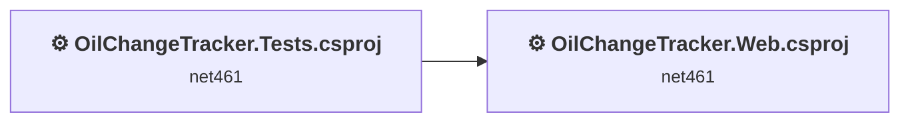
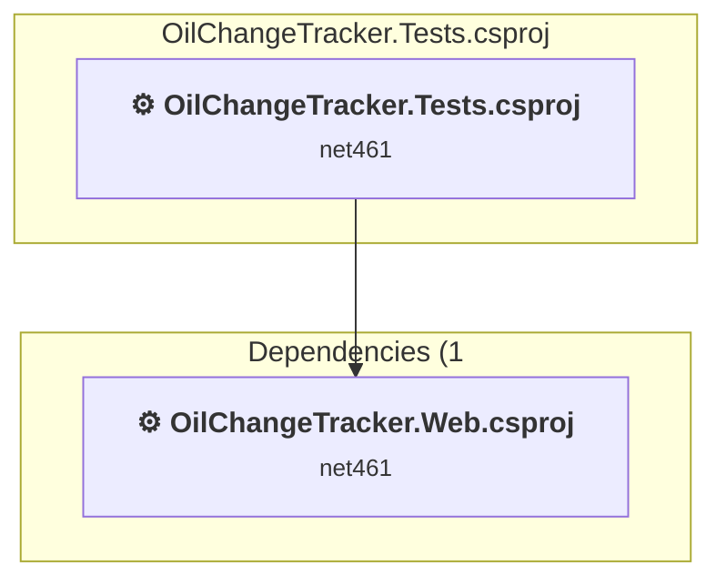
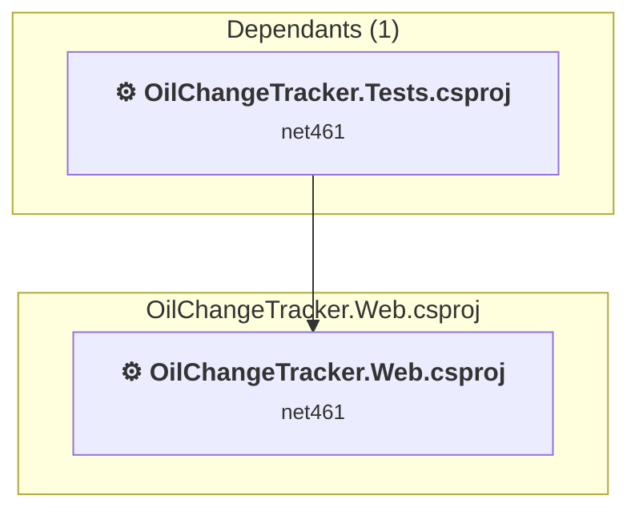

# Projects and dependencies analysis

This document provides a comprehensive overview of the projects and their dependencies in the context of upgrading to .NETCoreApp,Version=v10.0.

## Table of Contents

- [Executive Summary](#executive-Summary)
  - [Highlevel Metrics](#highlevel-metrics)
  - [Projects Compatibility](#projects-compatibility)
  - [Package Compatibility](#package-compatibility)
  - [API Compatibility](#api-compatibility)
- [Aggregate NuGet packages details](#aggregate-nuget-packages-details)
- [Top API Migration Challenges](#top-api-migration-challenges)
  - [Technologies and Features](#technologies-and-features)
  - [Most Frequent API Issues](#most-frequent-api-issues)
- [Projects Relationship Graph](#projects-relationship-graph)
- [Project Details](#project-details)

  - [OilChangeTracker.Tests\OilChangeTracker.Tests.csproj](#oilchangetrackertestsoilchangetrackertestscsproj)
  - [OilChangeTracker\OilChangeTracker.Web.csproj](#oilchangetrackeroilchangetrackerwebcsproj)

## Executive Summary

### Highlevel Metrics

| Metric | Count | Status |
| :--- | :---: | :--- |
| Total Projects | 2 | All require upgrade |
| Total NuGet Packages | 60 | 25 need upgrade |
| Total Code Files | 63 |  |
| Total Code Files with Incidents | 30 |  |
| Total Lines of Code | 3560 |  |
| Total Number of Issues | 856 |  |
| Estimated LOC to modify | 787+ | at least 22.1% of codebase |

### Projects Compatibility

| Project | Target Framework | Difficulty | Package Issues | API Issues | Est. LOC Impact | Description |
| :--- | :---: | :---: | :---: | :---: | :---: | :--- |
| [OilChangeTracker.Tests\OilChangeTracker.Tests.csproj](#oilchangetrackertestsoilchangetrackertestscsproj) | net461 | 🟢 Low | 5 | 1 | 1+ | ClassicClassLibrary, Sdk Style = False |
| [OilChangeTracker\OilChangeTracker.Web.csproj](#oilchangetrackeroilchangetrackerwebcsproj) | net461 | 🔴 High | 38 | 786 | 786+ | Wap, Sdk Style = False |

### Package Compatibility

| Status | Count | Percentage |
| :--- | :---: | :---: |
| ✅ Compatible | 35 | 58.3% |
| ⚠️ Incompatible | 15 | 25.0% |
| 🔄 Upgrade Recommended | 10 | 16.7% |
| ***Total NuGet Packages*** | ***60*** | ***100%*** |

### API Compatibility

| Category | Count | Impact |
| :--- | :---: | :--- |
| 🔴 Binary Incompatible | 762 | High - Require code changes |
| 🟡 Source Incompatible | 23 | Medium - Needs re-compilation and potential conflicting API error fixing |
| 🔵 Behavioral change | 2 | Low - Behavioral changes that may require testing at runtime |
| ✅ Compatible | 2926 |  |
| ***Total APIs Analyzed*** | ***3713*** |  |

## Aggregate NuGet packages details

| Package | Current Version | Suggested Version | Projects | Description |
| :--- | :---: | :---: | :--- | :--- |
| Antlr | 3.5.0.2 |  | [OilChangeTracker.Web.csproj](#oilchangetrackeroilchangetrackerwebcsproj) | Needs to be replaced with Replace with new package Antlr4=4.6.6 |
| AutoMapper | 16.1.1 |  | [OilChangeTracker.Web.csproj](#oilchangetrackeroilchangetrackerwebcsproj) | ✅Compatible |
| bootstrap | 5.3.8 |  | [OilChangeTracker.Web.csproj](#oilchangetrackeroilchangetrackerwebcsproj) | ✅Compatible |
| EntityFramework | 6.5.1 |  | [OilChangeTracker.Web.csproj](#oilchangetrackeroilchangetrackerwebcsproj) | ✅Compatible |
| jQuery | 3.7.1 |  | [OilChangeTracker.Web.csproj](#oilchangetrackeroilchangetrackerwebcsproj) | ✅Compatible |
| jQuery.Validation | 1.21.0 |  | [OilChangeTracker.Web.csproj](#oilchangetrackeroilchangetrackerwebcsproj) | ✅Compatible |
| Microsoft.AspNet.Identity.Core | 2.2.4 |  | [OilChangeTracker.Web.csproj](#oilchangetrackeroilchangetrackerwebcsproj) | ⚠️NuGet package is incompatible |
| Microsoft.AspNet.Identity.EntityFramework | 2.2.4 |  | [OilChangeTracker.Web.csproj](#oilchangetrackeroilchangetrackerwebcsproj) | ⚠️NuGet package is incompatible |
| Microsoft.AspNet.Identity.Owin | 2.2.4 |  | [OilChangeTracker.Web.csproj](#oilchangetrackeroilchangetrackerwebcsproj) | ⚠️NuGet package is incompatible |
| Microsoft.AspNet.Mvc | 5.2.4 |  | [OilChangeTracker.Tests.csproj](#oilchangetrackertestsoilchangetrackertestscsproj) | NuGet package functionality is included with framework reference |
| Microsoft.AspNet.Mvc | 5.3.0 |  | [OilChangeTracker.Web.csproj](#oilchangetrackeroilchangetrackerwebcsproj) | NuGet package functionality is included with framework reference |
| Microsoft.AspNet.Razor | 3.2.4 |  | [OilChangeTracker.Tests.csproj](#oilchangetrackertestsoilchangetrackertestscsproj) | NuGet package functionality is included with framework reference |
| Microsoft.AspNet.Razor | 3.3.0 |  | [OilChangeTracker.Web.csproj](#oilchangetrackeroilchangetrackerwebcsproj) | NuGet package functionality is included with framework reference |
| Microsoft.AspNet.TelemetryCorrelation | 1.0.8 | 1.0.3 | [OilChangeTracker.Web.csproj](#oilchangetrackeroilchangetrackerwebcsproj) | ⚠️NuGet package is incompatible |
| Microsoft.AspNet.Web.Optimization | 1.1.3 |  | [OilChangeTracker.Web.csproj](#oilchangetrackeroilchangetrackerwebcsproj) | ⚠️NuGet package is incompatible |
| Microsoft.AspNet.WebPages | 3.2.4 |  | [OilChangeTracker.Tests.csproj](#oilchangetrackertestsoilchangetrackertestscsproj) | NuGet package functionality is included with framework reference |
| Microsoft.AspNet.WebPages | 3.3.0 |  | [OilChangeTracker.Web.csproj](#oilchangetrackeroilchangetrackerwebcsproj) | NuGet package functionality is included with framework reference |
| Microsoft.Bcl.AsyncInterfaces | 10.0.0 | 10.0.5 | [OilChangeTracker.Web.csproj](#oilchangetrackeroilchangetrackerwebcsproj) | NuGet package upgrade is recommended |
| Microsoft.Bcl.HashCode | 6.0.0 |  | [OilChangeTracker.Web.csproj](#oilchangetrackeroilchangetrackerwebcsproj) | ✅Compatible |
| Microsoft.Bcl.TimeProvider | 8.0.1 | 10.0.5 | [OilChangeTracker.Web.csproj](#oilchangetrackeroilchangetrackerwebcsproj) | NuGet package upgrade is recommended |
| Microsoft.CSharp | 4.5.0 | 4.7.0 | [OilChangeTracker.Web.csproj](#oilchangetrackeroilchangetrackerwebcsproj) | NuGet package upgrade is recommended |
| Microsoft.Extensions.DependencyInjection.Abstractions | 10.0.0 | 10.0.5 | [OilChangeTracker.Web.csproj](#oilchangetrackeroilchangetrackerwebcsproj) | NuGet package upgrade is recommended |
| Microsoft.Extensions.Logging.Abstractions | 10.0.0 | 10.0.5 | [OilChangeTracker.Web.csproj](#oilchangetrackeroilchangetrackerwebcsproj) | NuGet package upgrade is recommended |
| Microsoft.Extensions.Options | 10.0.0 | 10.0.5 | [OilChangeTracker.Web.csproj](#oilchangetrackeroilchangetrackerwebcsproj) | NuGet package upgrade is recommended |
| Microsoft.Extensions.Primitives | 10.0.0 | 10.0.5 | [OilChangeTracker.Web.csproj](#oilchangetrackeroilchangetrackerwebcsproj) | NuGet package upgrade is recommended |
| Microsoft.IdentityModel.Abstractions | 8.14.0 |  | [OilChangeTracker.Web.csproj](#oilchangetrackeroilchangetrackerwebcsproj) | ✅Compatible |
| Microsoft.IdentityModel.JsonWebTokens | 8.14.0 |  | [OilChangeTracker.Web.csproj](#oilchangetrackeroilchangetrackerwebcsproj) | ✅Compatible |
| Microsoft.IdentityModel.Logging | 8.14.0 |  | [OilChangeTracker.Web.csproj](#oilchangetrackeroilchangetrackerwebcsproj) | ✅Compatible |
| Microsoft.IdentityModel.Tokens | 8.14.0 |  | [OilChangeTracker.Web.csproj](#oilchangetrackeroilchangetrackerwebcsproj) | ✅Compatible |
| Microsoft.jQuery.Unobtrusive.Validation | 4.0.0 |  | [OilChangeTracker.Web.csproj](#oilchangetrackeroilchangetrackerwebcsproj) | ✅Compatible |
| Microsoft.Owin | 4.2.3 |  | [OilChangeTracker.Web.csproj](#oilchangetrackeroilchangetrackerwebcsproj) | ⚠️NuGet package is incompatible |
| Microsoft.Owin.Host.SystemWeb | 4.2.3 |  | [OilChangeTracker.Web.csproj](#oilchangetrackeroilchangetrackerwebcsproj) | ⚠️NuGet package is incompatible |
| Microsoft.Owin.Security | 4.2.3 |  | [OilChangeTracker.Web.csproj](#oilchangetrackeroilchangetrackerwebcsproj) | ⚠️NuGet package is incompatible |
| Microsoft.Owin.Security.Cookies | 4.2.3 |  | [OilChangeTracker.Web.csproj](#oilchangetrackeroilchangetrackerwebcsproj) | ⚠️NuGet package is incompatible |
| Microsoft.Owin.Security.Facebook | 4.2.3 |  | [OilChangeTracker.Web.csproj](#oilchangetrackeroilchangetrackerwebcsproj) | ⚠️NuGet package is incompatible |
| Microsoft.Owin.Security.Google | 4.2.3 |  | [OilChangeTracker.Web.csproj](#oilchangetrackeroilchangetrackerwebcsproj) | ⚠️NuGet package is incompatible |
| Microsoft.Owin.Security.MicrosoftAccount | 4.2.3 |  | [OilChangeTracker.Web.csproj](#oilchangetrackeroilchangetrackerwebcsproj) | ⚠️NuGet package is incompatible |
| Microsoft.Owin.Security.OAuth | 4.2.3 |  | [OilChangeTracker.Web.csproj](#oilchangetrackeroilchangetrackerwebcsproj) | ⚠️NuGet package is incompatible |
| Microsoft.Owin.Security.Twitter | 4.2.3 |  | [OilChangeTracker.Web.csproj](#oilchangetrackeroilchangetrackerwebcsproj) | ⚠️NuGet package is incompatible |
| Microsoft.Web.Infrastructure | 1.0.0.0 |  | [OilChangeTracker.Tests.csproj](#oilchangetrackertestsoilchangetrackertestscsproj) | NuGet package functionality is included with framework reference |
| Microsoft.Web.Infrastructure | 2.0.0 |  | [OilChangeTracker.Web.csproj](#oilchangetrackeroilchangetrackerwebcsproj) | NuGet package functionality is included with framework reference |
| Modernizr | 2.8.3 |  | [OilChangeTracker.Web.csproj](#oilchangetrackeroilchangetrackerwebcsproj) | ✅Compatible |
| MSTest.TestAdapter | 1.2.0 |  | [OilChangeTracker.Tests.csproj](#oilchangetrackertestsoilchangetrackertestscsproj) | ✅Compatible |
| MSTest.TestFramework | 1.2.0 |  | [OilChangeTracker.Tests.csproj](#oilchangetrackertestsoilchangetrackertestscsproj) | ✅Compatible |
| Newtonsoft.Json | 13.0.3 | 13.0.4 | [OilChangeTracker.Tests.csproj](#oilchangetrackertestsoilchangetrackertestscsproj) | NuGet package upgrade is recommended |
| Newtonsoft.Json | 13.0.4 |  | [OilChangeTracker.Web.csproj](#oilchangetrackeroilchangetrackerwebcsproj) | ✅Compatible |
| Owin | 1.0 |  | [OilChangeTracker.Web.csproj](#oilchangetrackeroilchangetrackerwebcsproj) | ⚠️NuGet package is incompatible |
| System.Buffers | 4.6.1 |  | [OilChangeTracker.Web.csproj](#oilchangetrackeroilchangetrackerwebcsproj) | NuGet package functionality is included with framework reference |
| System.ComponentModel.Annotations | 5.0.0 |  | [OilChangeTracker.Web.csproj](#oilchangetrackeroilchangetrackerwebcsproj) | NuGet package functionality is included with framework reference |
| System.Diagnostics.DiagnosticSource | 10.0.5 |  | [OilChangeTracker.Web.csproj](#oilchangetrackeroilchangetrackerwebcsproj) | ✅Compatible |
| System.Memory | 4.6.3 |  | [OilChangeTracker.Web.csproj](#oilchangetrackeroilchangetrackerwebcsproj) | NuGet package functionality is included with framework reference |
| System.Numerics.Vectors | 4.6.1 |  | [OilChangeTracker.Web.csproj](#oilchangetrackeroilchangetrackerwebcsproj) | NuGet package functionality is included with framework reference |
| System.Reflection.Emit | 4.7.0 |  | [OilChangeTracker.Web.csproj](#oilchangetrackeroilchangetrackerwebcsproj) | NuGet package functionality is included with framework reference |
| System.Runtime.CompilerServices.Unsafe | 6.1.2 |  | [OilChangeTracker.Web.csproj](#oilchangetrackeroilchangetrackerwebcsproj) | ✅Compatible |
| System.Security.Cryptography.Cng | 4.5.0 |  | [OilChangeTracker.Web.csproj](#oilchangetrackeroilchangetrackerwebcsproj) | NuGet package functionality is included with framework reference |
| System.Text.Encodings.Web | 8.0.0 | 10.0.5 | [OilChangeTracker.Web.csproj](#oilchangetrackeroilchangetrackerwebcsproj) | NuGet package upgrade is recommended |
| System.Text.Json | 8.0.5 | 10.0.5 | [OilChangeTracker.Web.csproj](#oilchangetrackeroilchangetrackerwebcsproj) | NuGet package upgrade is recommended |
| System.Threading.Tasks.Extensions | 4.6.3 |  | [OilChangeTracker.Web.csproj](#oilchangetrackeroilchangetrackerwebcsproj) | NuGet package functionality is included with framework reference |
| System.ValueTuple | 4.6.2 |  | [OilChangeTracker.Web.csproj](#oilchangetrackeroilchangetrackerwebcsproj) | NuGet package functionality is included with framework reference |
| WebGrease | 1.6.0 |  | [OilChangeTracker.Web.csproj](#oilchangetrackeroilchangetrackerwebcsproj) | ✅Compatible |

## Top API Migration Challenges

### Technologies and Features

| Technology | Issues | Percentage | Migration Path |
| :--- | :---: | :---: | :--- |
| ASP.NET Framework (System.Web) | 592 | 75.2% | Legacy ASP.NET Framework APIs for web applications (System.Web.*) that don't exist in ASP.NET Core due to architectural differences. ASP.NET Core represents a complete redesign of the web framework. Migrate to ASP.NET Core equivalents or consider System.Web.Adapters package for compatibility. |

### Most Frequent API Issues

| API | Count | Percentage | Category |
| :--- | :---: | :---: | :--- |
| T:System.Web.Mvc.ViewResult | 58 | 7.4% | Binary Incompatible |
| T:System.Web.Mvc.ActionResult | 33 | 4.2% | Binary Incompatible |
| P:System.Web.Mvc.Controller.User | 33 | 4.2% | Binary Incompatible |
| T:Microsoft.AspNet.Identity.IdentityExtensions | 30 | 3.8% | Binary Incompatible |
| M:Microsoft.AspNet.Identity.IdentityExtensions.GetUserId(System.Security.Principal.IIdentity) | 30 | 3.8% | Binary Incompatible |
| T:System.Web.Mvc.RedirectToRouteResult | 26 | 3.3% | Binary Incompatible |
| M:System.Web.Mvc.Controller.View(System.Object) | 24 | 3.0% | Binary Incompatible |
| T:Microsoft.AspNet.Identity.Owin.SignInStatus | 22 | 2.8% | Binary Incompatible |
| M:System.Web.Mvc.HttpPostAttribute.#ctor | 21 | 2.7% | Binary Incompatible |
| T:System.Web.Mvc.HttpPostAttribute | 21 | 2.7% | Binary Incompatible |
| M:System.Web.Mvc.ValidateAntiForgeryTokenAttribute.#ctor | 19 | 2.4% | Binary Incompatible |
| T:System.Web.Mvc.ValidateAntiForgeryTokenAttribute | 19 | 2.4% | Binary Incompatible |
| T:System.Web.Mvc.ModelStateDictionary | 19 | 2.4% | Binary Incompatible |
| P:System.Web.Mvc.Controller.ModelState | 19 | 2.4% | Binary Incompatible |
| M:System.Web.Mvc.AllowAnonymousAttribute.#ctor | 19 | 2.4% | Binary Incompatible |
| T:System.Web.Mvc.AllowAnonymousAttribute | 19 | 2.4% | Binary Incompatible |
| M:System.Web.Mvc.Controller.View | 15 | 1.9% | Binary Incompatible |
| M:System.Web.Mvc.Controller.View(System.String) | 15 | 1.9% | Binary Incompatible |
| P:System.Web.Mvc.ModelStateDictionary.IsValid | 14 | 1.8% | Binary Incompatible |
| M:System.Web.Mvc.Controller.#ctor | 13 | 1.7% | Binary Incompatible |
| M:System.Web.Mvc.Controller.RedirectToAction(System.String,System.String) | 12 | 1.5% | Binary Incompatible |
| P:System.Web.Mvc.ControllerBase.ViewBag | 12 | 1.5% | Binary Incompatible |
| M:System.Web.Mvc.Controller.RedirectToAction(System.String,System.Object) | 12 | 1.5% | Binary Incompatible |
| P:Microsoft.AspNet.Identity.IdentityResult.Succeeded | 11 | 1.4% | Binary Incompatible |
| M:System.Web.Mvc.AuthorizeAttribute.#ctor | 10 | 1.3% | Binary Incompatible |
| T:System.Web.Mvc.AuthorizeAttribute | 10 | 1.3% | Binary Incompatible |
| T:System.Web.HttpContextBase | 6 | 0.8% | Source Incompatible |
| P:System.Web.Mvc.Controller.HttpContext | 6 | 0.8% | Binary Incompatible |
| T:Microsoft.AspNet.Identity.DefaultAuthenticationTypes | 6 | 0.8% | Binary Incompatible |
| T:Microsoft.AspNet.Identity.Owin.OwinContextExtensions | 6 | 0.8% | Binary Incompatible |
| T:Microsoft.AspNet.Identity.IIdentityMessageService | 6 | 0.8% | Binary Incompatible |
| T:System.Web.Configuration.WebConfigurationManager | 6 | 0.8% | Binary Incompatible |
| P:System.Web.Configuration.WebConfigurationManager.AppSettings | 6 | 0.8% | Binary Incompatible |
| T:Owin.AppBuilderExtensions | 6 | 0.8% | Binary Incompatible |
| T:System.Web.Mvc.Controller | 5 | 0.6% | Binary Incompatible |
| T:System.Web.Mvc.UrlHelper | 5 | 0.6% | Binary Incompatible |
| P:System.Web.Mvc.Controller.Url | 5 | 0.6% | Binary Incompatible |
| M:System.Web.Mvc.ModelStateDictionary.AddModelError(System.String,System.String) | 5 | 0.6% | Binary Incompatible |
| T:Microsoft.Owin.Security.AuthenticationManagerExtensions | 5 | 0.6% | Binary Incompatible |
| T:System.Web.Optimization.Bundle | 5 | 0.6% | Binary Incompatible |
| M:System.Web.Optimization.BundleCollection.Add(System.Web.Optimization.Bundle) | 5 | 0.6% | Binary Incompatible |
| T:System.Web.HttpSessionStateBase | 4 | 0.5% | Source Incompatible |
| P:System.Web.Mvc.Controller.Session | 4 | 0.5% | Binary Incompatible |
| P:System.Web.HttpSessionStateBase.Item(System.String) | 4 | 0.5% | Source Incompatible |
| M:System.Web.Mvc.Controller.View(System.String,System.Object) | 4 | 0.5% | Binary Incompatible |
| T:Microsoft.AspNet.Identity.UserLoginInfo | 4 | 0.5% | Binary Incompatible |
| T:System.Web.Optimization.ScriptBundle | 4 | 0.5% | Binary Incompatible |
| M:System.Web.Optimization.ScriptBundle.#ctor(System.String) | 4 | 0.5% | Binary Incompatible |
| M:System.Web.Optimization.Bundle.Include(System.String,System.Web.Optimization.IItemTransform[]) | 4 | 0.5% | Binary Incompatible |
| F:Microsoft.AspNet.Identity.DefaultAuthenticationTypes.ApplicationCookie | 3 | 0.4% | Binary Incompatible |

## Projects Relationship Graph

Legend:
📦 SDK-style project
⚙️ Classic project

## Project Details

### OilChangeTracker.Tests\OilChangeTracker.Tests.csproj

#### Project Info

- **Current Target Framework:** net461
- **Proposed Target Framework:** net10.0
- **SDK-style**: False
- **Project Kind:** ClassicClassLibrary
- **Dependencies**: 1
- **Dependants**: 0
- **Number of Files**: 6
- **Number of Files with Incidents**: 2
- **Lines of Code**: 83
- **Estimated LOC to modify**: 1+ (at least 1.2% of the project)

#### Dependency Graph

Legend:
📦 SDK-style project
⚙️ Classic project

### API Compatibility

| Category | Count | Impact |
| :--- | :---: | :--- |
| 🔴 Binary Incompatible | 1 | High - Require code changes |
| 🟡 Source Incompatible | 0 | Medium - Needs re-compilation and potential conflicting API error fixing |
| 🔵 Behavioral change | 0 | Low - Behavioral changes that may require testing at runtime |
| ✅ Compatible | 23 |  |
| ***Total APIs Analyzed*** | ***24*** |  |

#### Project Technologies and Features

| Technology | Issues | Percentage | Migration Path |
| :--- | :---: | :---: | :--- |
| ASP.NET Framework (System.Web) | 1 | 100.0% | Legacy ASP.NET Framework APIs for web applications (System.Web.*) that don't exist in ASP.NET Core due to architectural differences. ASP.NET Core represents a complete redesign of the web framework. Migrate to ASP.NET Core equivalents or consider System.Web.Adapters package for compatibility. |

### OilChangeTracker\OilChangeTracker.Web.csproj

#### Project Info

- **Current Target Framework:** net461
- **Proposed Target Framework:** net10.0
- **SDK-style**: False
- **Project Kind:** Wap
- **Dependencies**: 0
- **Dependants**: 1
- **Number of Files**: 130
- **Number of Files with Incidents**: 28
- **Lines of Code**: 3477
- **Estimated LOC to modify**: 786+ (at least 22.6% of the project)

#### Dependency Graph

Legend:
📦 SDK-style project
⚙️ Classic project

### API Compatibility

| Category | Count | Impact |
| :--- | :---: | :--- |
| 🔴 Binary Incompatible | 761 | High - Require code changes |
| 🟡 Source Incompatible | 23 | Medium - Needs re-compilation and potential conflicting API error fixing |
| 🔵 Behavioral change | 2 | Low - Behavioral changes that may require testing at runtime |
| ✅ Compatible | 2903 |  |
| ***Total APIs Analyzed*** | ***3689*** |  |

#### Project Technologies and Features

| Technology | Issues | Percentage | Migration Path |
| :--- | :---: | :---: | :--- |
| ASP.NET Framework (System.Web) | 591 | 75.2% | Legacy ASP.NET Framework APIs for web applications (System.Web.*) that don't exist in ASP.NET Core due to architectural differences. ASP.NET Core represents a complete redesign of the web framework. Migrate to ASP.NET Core equivalents or consider System.Web.Adapters package for compatibility. |

